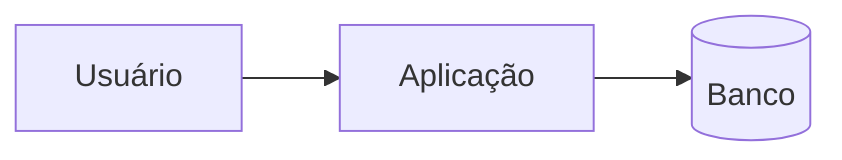

# Infraestrutura

> Onde o sistema roda, do que depende e onde estão os dados de cada ambiente.
> **Nomes, hosts e caminhos sim; valor de segredo nunca** (senha, token, string
> de conexão com senha): aponte o path do cofre. Campo que ninguém confirmou fica
> `A DEFINIR`. A seção "Detectado no repositório" vem do inventário
> (`tools/mapeia_projeto.py`); o resto é confirmado por uma pessoa.

Última revisão: `A DEFINIR` — por `A DEFINIR`

## Stack

| Camada | Tecnologia e versão | Origem |
|---|---|---|
| Linguagem / runtime | A DEFINIR | manifesto (`go.mod`, `package.json`…) |
| Framework | A DEFINIR | |
| Banco de dados | A DEFINIR (ex.: PostgreSQL 16) | |
| Fila / cache / storage | A DEFINIR | |
| Front-end | A DEFINIR (ou "não tem") | |

Versões e decisões detalhadas: `Padroes/stack-tecnologico.md`.

## Onde roda

| | hml | prod |
|---|---|---|
| Provedor / data center | A DEFINIR | A DEFINIR |
| Cluster / servidor | A DEFINIR (ex.: Nomad, namespace `app-hml`) | A DEFINIR |
| Região | A DEFINIR | A DEFINIR |
| Como se chega (VPN, bastion, público) | A DEFINIR | A DEFINIR |
| URL da aplicação | A DEFINIR | A DEFINIR |

## Bancos de dados

Uma linha por banco. Para achar a credencial, o caminho no cofre — nunca o valor.

| Banco | Motor e versão | hml (host / instância / nome) | prod (host / instância / nome) | Credencial (path no cofre) | Backup e restore |
|---|---|---|---|---|---|
| A DEFINIR | A DEFINIR | A DEFINIR | A DEFINIR | A DEFINIR | A DEFINIR |

Migrations: ferramenta, pasta e comandos de dev ficam no `migrations.md`, ao lado
do `INDEX.md` (guia `util-e-migrations.md` da skill novo-projeto-sdd). Aqui só o
que é do ambiente — quem pode escrever em prod: `A DEFINIR`.

## Outros recursos

| Recurso | hml | prod | Observação |
|---|---|---|---|
| Fila / broker | | | |
| Cache | | | |
| Storage de arquivos | | | |
| Serviços externos (e-mail, pagamento…) | | | sandbox × produção |
| Observabilidade (log, métrica, alerta) | | | |

## Diagrama

## Detectado no repositório

Preencha a partir de `System/mapa/inventario.md` (Docker, Compose, CI, jobs
Nomad, migrations, variáveis de ambiente lidas). O que aparece aqui e não nas
tabelas acima é informação faltando; o que está nas tabelas e não aparece aqui
precisa de explicação.

- A DEFINIR
