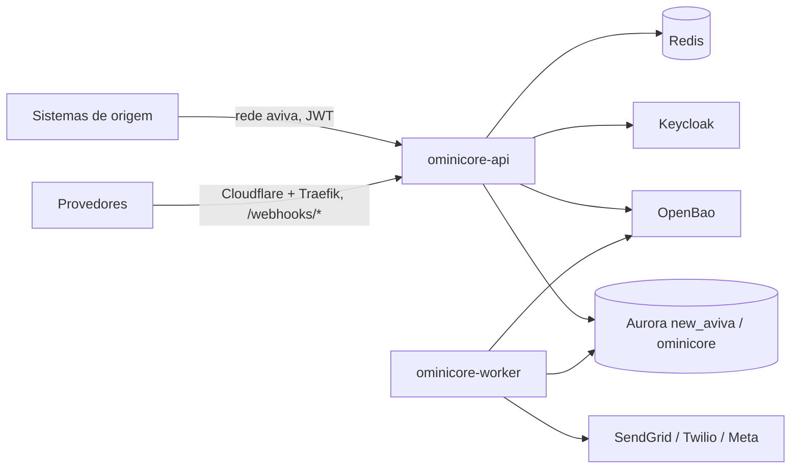

# Infraestrutura

> Onde o sistema roda, do que depende e onde estão os dados de cada ambiente.
> **Nomes, hosts e caminhos sim; valor de segredo nunca** (senha, token, string
> de conexão com senha): aponte o path do cofre. Campo que ninguém confirmou fica
> marcado como pendente. A seção "Detectado no repositório" vem do inventário
> (`tools/mapeia_projeto.py`); o resto é confirmado por uma pessoa.

Última revisão: `2026-10-02` — por Claude, a partir das decisões do dono em
`Infra/AMBIENTES.md` (2026-09-29) e `Padroes/stack-tecnologico.md`; **a revisar
pelo dono**. hml e prod estão decididos, não criados (`deploy/aviva2/README.md`).

## Stack

| Camada | Tecnologia e versão | Origem |
|---|---|---|
| Linguagem / runtime | Go 1.27 (`go 1.27.0`), binário estático `CGO_ENABLED=0` | `go.mod` |
| Framework | `net/http` da stdlib; arquitetura hexagonal | `Padroes/stack-tecnologico.md` |
| Banco de dados | PostgreSQL (Aurora; local e testes: Postgres 17) | `AMBIENTES.md`, `deploy/local/compose.yaml` |
| Fila / cache / storage | fila = tabela `tentativas` no Postgres (ADR 0001); Redis 7.4 (cache do JWKS); sem storage de arquivos | `System/decisoes/0001-*`, `compose.yaml` |
| Front-end | não tem (API interna + webhooks) | `System/arquitetura.md` |

Versões e decisões detalhadas: `Padroes/stack-tecnologico.md`.

## Onde roda

| | hml | prod |
|---|---|---|
| Provedor / data center | AWS EC2 `i-044194deaab7ca807` (aviva2.0, t4g arm64) | o mesmo host |
| Cluster / servidor | quadlets Podman `ominicore-hml-{api,worker}` na rede `aviva` | quadlets `ominicore-{api,worker}` |
| Região | us-east-1 (host); banco em sa-east-1 | idem |
| Como se chega (VPN, bastion, público) | API só pela rede `aviva`; SSH com `~/.ssh/aviva2.0.pem`; webhooks públicos via Traefik + Cloudflare | idem |
| URL da aplicação | `http://ominicore-api-hml:8080` (interna) · `https://notify-hml.flipapi.com.br/webhooks/*` | `http://ominicore-api:8080` · `https://notify.flipapi.com.br/webhooks/*` |

## Bancos de dados

Uma linha por banco. Para achar a credencial, o caminho no cofre — nunca o valor.

| Banco | Motor e versão | hml (host / instância / nome) | prod (host / instância / nome) | Credencial (path no cofre) | Backup e restore |
|---|---|---|---|---|---|
| OminiCore | Aurora PostgreSQL 15.15 (provisioned) | `db-zillionvf-prod` / `new_aviva`, schema `ominicore_hml` | `db-zillionvf-prod` / `new_aviva`, schema `ominicore` | `kv/ominicore-hml/postgres` · `kv/ominicore/postgres` (`dsn`) | backup automático do cluster: retenção de 2 dias, janela 00:20–00:50 UTC; restore é do cluster inteiro (compartilhado com o zillion) |

Retenção dos dados (RN-9): o worker anonimiza Notificações finalizadas com mais
de `OMINICORE_RETENCAO_DIAS` (30) dias, a cada 1 h. O backup de 2 dias ainda
guarda dado anterior à anonimização por até 2 dias.

Fonte do cluster: `../flip/aws/runbook-migracao-aurora-us-east-1.md` (conferir se a
migração do Aurora para us-east-1 já aconteceu antes do primeiro deploy). Backup
de 2 dias é curto para o OminiCore — o Opt-out (`opt_outs`) não pode ser perdido;
avaliar retenção maior ou dump próprio do schema.

Migrations: `goose` embutido no binário (`ominicore migrate`), pasta
`migrations/`; em hml/prod rodam pelo `deploy/aviva2/publicar.sh` antes de trocar
o binário, só aditivas. Quem pode escrever em prod: só o dono (`AMBIENTES.md` §4).

## Outros recursos

| Recurso | hml | prod | Observação |
|---|---|---|---|
| Fila / broker | tabela `tentativas` (`ominicore_hml`) | tabela `tentativas` (`ominicore`) | sem broker (ADR 0001) |
| Cache | Redis do aviva2.0 (`redis:6379`, `requirepass`) | o mesmo | só JWKS; chave inclui o realm |
| Storage de arquivos | — | — | não usa |
| Serviços externos | SendGrid, Twilio e Meta em sandbox | contas de produção | credenciais em `kv/<prefixo>/{sendgrid,twilio,whatsapp,webhooks}`; `whatsapp` opcional (sem ele o Canal fica desligado) |
| Identidade e cofre | Keycloak realm `ominicore-hml`; OpenBao `kv/ominicore-hml/*` | realm `ominicore`; `kv/ominicore/*` | Keycloak e OpenBao da casa, no mesmo host |
| Observabilidade | `slog` JSON no journald | idem | sem métricas/alerta ainda |

## Diagrama

## Detectado no repositório

Do `System/mapa/inventario.md`:

- Compose local: `deploy/local/compose.yaml` (Postgres 17, Redis 7.4, OpenBao 2.6.3, Keycloak 26.3).
- Deploy: `deploy/aviva2/` (template de quadlet, env, rota do Traefik, scripts de realm e cofre, `publicar.sh`).
- CI: `.github/workflows/go.yml`, `sdd-checks.yml`, `dependabot-automerge.yml`.
- Migrations: `migrations/00001` a `00006`.
- Variáveis `OMINICORE_*`: lidas em `cmd/ominicore/main.go`; lista em `deploy/local/README.md`.
