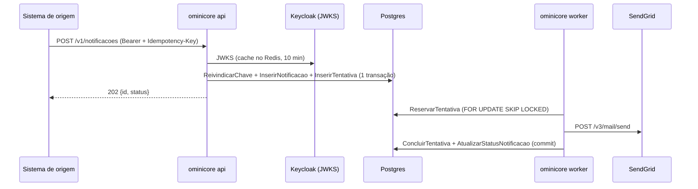

> Revisado por: Mauricio Miwa, 2026-09-28

# Envio

> Fatos do inventário de 2026-09-28 (`inventario.md`) e do código da change
> `01-enviar-email`; deduções marcadas com (deduzido). Revisado por: —, —.

## Para que serve
Um Sistema de origem autenticado pede uma Notificação por Template; o worker a
envia pelo Canal Email (SendGrid), sem duplicar em reenvio (RN-1, RN-3, RN-7).

## Telas / entradas
| Rota | Tela | Arquivo |
|---|---|---|
| `POST /v1/notificacoes` | — (API; contrato em `api/openapi.yaml`) | `internal/adaptadores/entrada/http/servidor.go:34` |
| `GET /healthz` | — (healthcheck do quadlet) | `internal/adaptadores/entrada/http/servidor.go:33` |
| worker (fila no Postgres) | — | `internal/adaptadores/entrada/worker/worker.go` |

## Fluxo principal

## Chamadas ao back
| Método | Endpoint | Chamado em | Para quê |
|---|---|---|---|
| POST | SendGrid `/v3/mail/send` | `internal/adaptadores/saida/sendgrid/sendgrid.go:77` | enviar a Tentativa de Email |
| GET | Keycloak `<realm>/protocol/openid-connect/certs` | `internal/adaptadores/saida/keycloak/validador.go` | JWKS para validar o token |
| POST | Keycloak `<realm>/protocol/openid-connect/token` | `internal/adaptadores/saida/keycloak/token.go:17` | token do próprio OminiCore para o OpenBao |
| — | OpenBao `auth/jwt/login`, `kv/data/ominicore/*` | `internal/adaptadores/saida/openbao/segredos.go` | credenciais no boot (REQ-6) |

## Estado e dados
Tabelas (schema `ominicore`, `migrations/00001_notificacoes.sql`): `templates`,
`template_conteudos`, `notificacoes`, `idempotencia` (chave por Sistema de
origem, `expira_em` = 24 h), `tentativas` (a fila). Seed: Template
`boas-vindas` (`migrations/00002_seed_template_boas_vindas.sql`).

## Regras de negócio encontradas (a confirmar)
Nenhuma além das RN da especificação.
- (deduzido) Pedido cujo Destinatário não tem contato para o 1º Canal é
  recusado com 422 (`aplicacao/enviar.go`) — decorre de RN-1, mas não está
  escrito como critério; confirmar.

## Specs
Specs vigentes `openspec/specs/autenticacao-origem/`, `notificacoes/` e
`segredos/` (REQ-1 a REQ-6); histórico em
`openspec/changes/archive/2026-09-29-01-enviar-email/`.
