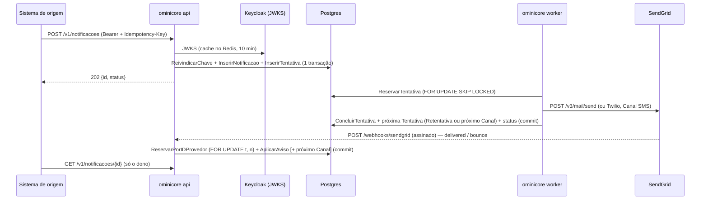

> Revisado por: Mauricio Miwa, 2026-09-28

# Envio

> Fatos do inventário de 2026-09-28 (`inventario.md`) e do código da change
> `01-enviar-email`; deduções marcadas com (deduzido). Revisado por: —, —.

## Para que serve
Um Sistema de origem autenticado pede uma Notificação por Template; o worker a
envia pelos Canais Email (SendGrid), SMS (Twilio) e WhatsApp (Meta, Modelo
aprovado, ou UltraMsg, texto — um Provedor por ambiente) na Ordem de Canais, com
Retentativa de Falha temporária e fallback para o próximo Canal, sem duplicar
em reenvio (RN-1, RN-2, RN-3, RN-4, RN-7); Avisos de status atualizam a Tentativa e o
Sistema de origem consulta o resultado (RN-5); Canal em Opt-out é pulado no
pedido, no fallback e no envio (RN-8); o worker anonimiza as Notificações finalizadas
depois do prazo de retenção (RN-9).

## Telas / entradas
| Rota | Tela | Arquivo |
|---|---|---|
| `POST /v1/notificacoes` | — (API; contrato em `api/openapi.yaml`) | `internal/adaptadores/entrada/http/servidor.go:34` |
| `GET /healthz` | — (healthcheck do quadlet) | `internal/adaptadores/entrada/http/servidor.go:33` |
| `GET /v1/notificacoes/{id}` | — (consulta do dono, REQ-14) | `internal/adaptadores/entrada/http/servidor.go` |
| `POST /webhooks/{sendgrid,twilio,whatsapp}`, `GET /webhooks/whatsapp` | — (públicos, Aviso de status assinado, REQ-12; as rotas da Meta só existem com o WhatsApp ligado pela Meta, senão 404 — REQ-20, REQ-21) | `internal/adaptadores/entrada/webhooks/` |
| `POST`/`DELETE /v1/opt-outs` | — (Opt-out por contato + Canal, REQ-15) | `internal/adaptadores/entrada/http/servidor.go` |
| worker (fila no Postgres) | — | `internal/adaptadores/entrada/worker/worker.go` |
| worker (retenção, a cada 1 h) | — | `internal/adaptadores/entrada/worker/retencao.go` |

## Fluxo principal

## Chamadas ao back
| Método | Endpoint | Chamado em | Para quê |
|---|---|---|---|
| POST | SendGrid `/v3/mail/send` | `internal/adaptadores/saida/sendgrid/sendgrid.go` | enviar a Tentativa de Email |
| POST | Twilio `/2010-04-01/Accounts/{sid}/Messages.json` | `internal/adaptadores/saida/twilio/twilio.go` | enviar a Tentativa de SMS |
| POST | Meta `/v26.0/{phone_number_id}/messages` | `internal/adaptadores/saida/whatsapp/whatsapp.go` | enviar a Tentativa de WhatsApp (Modelo aprovado) |
| POST | UltraMsg `/{instance_id}/messages/chat` (form, token no corpo) | `internal/adaptadores/saida/ultramsg/ultramsg.go` | enviar a Tentativa de WhatsApp (texto, até 4096) |
| GET | Keycloak `<realm>/protocol/openid-connect/certs` | `internal/adaptadores/saida/keycloak/validador.go` | JWKS para validar o token |
| POST | Keycloak `<realm>/protocol/openid-connect/token` | `internal/adaptadores/saida/keycloak/token.go:17` | token do próprio OminiCore para o OpenBao |
| — | OpenBao `auth/jwt/login`, `kv/data/ominicore/*` | `internal/adaptadores/saida/openbao/segredos.go` | credenciais no boot (REQ-6) |

## Estado e dados
Tabelas (schema `ominicore`, `migrations/00001_notificacoes.sql`): `templates`,
`template_conteudos`, `notificacoes`, `idempotencia` (chave por Sistema de
origem, `expira_em` = 24 h), `tentativas` (a fila; Retentativa = nova linha
com `disponivel_em` no futuro; `categoria_falha` e índice por `id_provedor`, `00005_*`). Seed: Template `boas-vindas`, Email → SMS
(`migrations/00002_*`, `00003_sms.sql`, `00004_whatsapp.sql` — versão WhatsApp com Modelo aprovado; `00008_whatsapp_texto.sql` — texto para o UltraMsg); `opt_outs` e `opt_out_eventos` (`00006_*`, só HMAC do contato); `notificacoes.anonimizada_em` (`00007_*`); `notificacoes.destinatario_telefone` (E.164).

## Regras de negócio encontradas (a confirmar)
Nenhuma além das RN da especificação.
- (deduzido) `canais` repetido no pedido é recusado com 400
  (`entrada/http/servidor.go`, `validarFormato`) — formato, não regra; confirmar.

## Specs
Specs vigentes `openspec/specs/autenticacao-origem/`, `notificacoes/` e
`segredos/` (REQ-1 a REQ-19); histórico em `openspec/changes/archive/`
(`2026-09-29-01-enviar-email`, `2026-09-29-02-sms-e-fallback`, `2026-09-29-03-status-por-webhook`, `2026-09-29-06-whatsapp`, `2026-10-02-04-opt-out`, `2026-10-02-05-retencao`).
