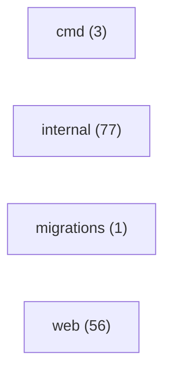

# Inventário do código — ominicore

> GERADO por `tools/mapeia_projeto.py` em 2026-10-29T16:37:03. Não edite: rode o script de novo.
> A interpretação (o que cada área faz, fluxos, RN candidatas) está nas outras páginas desta pasta.

## Stack

| Manifesto | Linguagem | Frameworks | Deps |
|---|---|---|---|
| `go.mod` | go | — | — |
| `web/console/package.json` | js/ts | vue@^3.5.43, vue-router@^4.6.4 | 46 |
| `web/console/src/plugins/iconify/package.json` | js/ts | — | — |

## Módulos

| Módulo | Arquivos | Importa |
|---|---|---|
| `internal` | 77 | — |
| `web` | 56 | — |
| `cmd` | 3 | — |
| `migrations` | 1 | — |

## Rotas de front (8)

| Rota | Nome | Título | Componente | Onde |
|---|---|---|---|---|
| `/` | — | — | `src/layouts/blank.vue` | `web/console/src/plugins/router/routes.ts:2` |
| `` | — | — | `src/pages/index.vue` | `web/console/src/plugins/router/routes.ts:2` |
| `/callback/:ambiente` | — | — | `src/layouts/blank.vue` | `web/console/src/plugins/router/routes.ts:3` |
| `` | — | — | `src/pages/callback.vue` | `web/console/src/plugins/router/routes.ts:3` |
| `/` | — | — | `src/layouts/default.vue` | `web/console/src/plugins/router/routes.ts:5` |
| `whatsapp` | — | — | `src/pages/whatsapp.vue` | `web/console/src/plugins/router/routes.ts:9` |
| `/:pathMatch(.*)*` | — | — | `src/layouts/blank.vue` | `web/console/src/plugins/router/routes.ts:12` |
| `` | — | — | `src/pages/erro.vue` | `web/console/src/plugins/router/routes.ts:12` |

## Endpoints (22)

| Método | Caminho | Onde |
|---|---|---|
| GET | `/healthz` | `internal/adaptadores/entrada/http/servidor.go`:49 |
| DELETE | `/v1/config/whatsapp` | `api/openapi.yaml` (contrato) |
| DELETE | `/v1/config/whatsapp` | `internal/adaptadores/entrada/http/servidor.go`:58 |
| GET | `/v1/config/whatsapp` | `api/openapi.yaml` (contrato) |
| GET | `/v1/config/whatsapp` | `internal/adaptadores/entrada/http/servidor.go`:56 |
| PUT | `/v1/config/whatsapp` | `api/openapi.yaml` (contrato) |
| PUT | `/v1/config/whatsapp` | `internal/adaptadores/entrada/http/servidor.go`:57 |
| POST | `/v1/config/whatsapp/webhooks` | `api/openapi.yaml` (contrato) |
| POST | `/v1/config/whatsapp/webhooks` | `internal/adaptadores/entrada/http/servidor.go`:60 |
| POST | `/v1/notificacoes` | `api/openapi.yaml` (contrato) |
| POST | `/v1/notificacoes` | `internal/adaptadores/entrada/http/servidor.go`:50 |
| GET | `/v1/notificacoes/{id}` | `api/openapi.yaml` (contrato) |
| GET | `/v1/notificacoes/{id}` | `internal/adaptadores/entrada/http/servidor.go`:51 |
| DELETE | `/v1/opt-outs` | `api/openapi.yaml` (contrato) |
| DELETE | `/v1/opt-outs` | `internal/adaptadores/entrada/http/servidor.go`:53 |
| POST | `/v1/opt-outs` | `api/openapi.yaml` (contrato) |
| POST | `/v1/opt-outs` | `internal/adaptadores/entrada/http/servidor.go`:52 |
| POST | `/webhooks/sendgrid` | `internal/adaptadores/entrada/webhooks/webhooks.go`:64 |
| POST | `/webhooks/twilio` | `internal/adaptadores/entrada/webhooks/webhooks.go`:65 |
| GET | `/webhooks/whatsapp` | `internal/adaptadores/entrada/webhooks/webhooks.go`:66 |
| POST | `/webhooks/whatsapp` | `internal/adaptadores/entrada/webhooks/webhooks.go`:67 |
| POST | `/webhooks/zapi/{segredo}` | `internal/adaptadores/entrada/webhooks/webhooks.go`:68 |

## Chamadas HTTP de saída (2)

| Método | URL | Onde |
|---|---|---|
| POST | `/protocol/openid-connect/token` | `internal/adaptadores/saida/keycloak/token.go:17` |
| POST | `/v3/mail/send` | `internal/adaptadores/saida/sendgrid/sendgrid.go:78` |

## Variáveis de ambiente lidas no código (21)

| Variável | Declarada em .env* | Onde é lida |
|---|---|---|
| `COMPOSE` | **não** | `deploy/local/bootstrap.sh` |
| `HOST` | **não** | `deploy/aviva2/publicar.sh` |
| `KC_ADMIN_USUARIO` | **não** | `deploy/aviva2/keycloak/lib-admin.sh` |
| `KC_DEPLOY_CLIENT` | **não** | `deploy/aviva2/keycloak/lib-admin.sh` |
| `KEY` | **não** | `deploy/aviva2/publicar.sh` |
| `NODE_ENV` | **não** | `web/console/.eslintrc.cjs` |
| `SENDGRID_API_KEY` | **não** | `deploy/local/bootstrap.sh` |
| `SENDGRID_REMETENTE` | **não** | `deploy/local/bootstrap.sh` |
| `SUFIXO` | **não** | `deploy/aviva2/keycloak/criar-realm.sh`, `deploy/aviva2/publicar.sh` |
| `TWILIO_ACCOUNT_SID` | **não** | `deploy/local/bootstrap.sh` |
| `TWILIO_API_KEY_SECRET` | **não** | `deploy/local/bootstrap.sh` |
| `TWILIO_API_KEY_SID` | **não** | `deploy/local/bootstrap.sh` |
| `TWILIO_MESSAGING_SERVICE_SID` | **não** | `deploy/local/bootstrap.sh` |
| `ULTRAMSG_INSTANCE_ID` | **não** | `deploy/local/bootstrap.sh` |
| `ULTRAMSG_TOKEN` | **não** | `deploy/local/bootstrap.sh` |
| `WHATSAPP_PHONE_NUMBER_ID` | **não** | `deploy/local/bootstrap.sh` |
| `WHATSAPP_PROVEDOR` | **não** | `deploy/local/bootstrap.sh` |
| `WHATSAPP_TOKEN` | **não** | `deploy/local/bootstrap.sh` |
| `ZAPI_CLIENT_TOKEN` | **não** | `deploy/local/bootstrap.sh` |
| `ZAPI_INSTANCE_ID` | **não** | `deploy/local/bootstrap.sh` |
| `ZAPI_TOKEN` | **não** | `deploy/local/bootstrap.sh` |

## Dados

- Migrations: `migrations`
- Schemas/modelos: —
- Arquivos .sql: 11

## Infra

- docker: —
- compose: `deploy/local/compose.yaml`
- nomad: —
- ci: `.github/workflows/console.yml`, `.github/workflows/dependabot-automerge.yml`, `.github/workflows/go.yml`, `.github/workflows/sdd-checks.yml`
