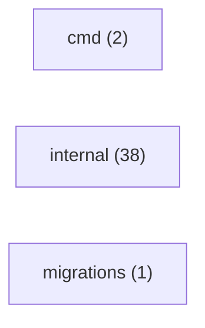

# Inventário do código — ominicore

> GERADO por `tools/mapeia_projeto.py` em 2026-09-29T16:30:01. Não edite: rode o script de novo.
> A interpretação (o que cada área faz, fluxos, RN candidatas) está nas outras páginas desta pasta.

## Stack

| Manifesto | Linguagem | Frameworks | Deps |
|---|---|---|---|
| `go.mod` | go | — | — |

## Módulos

| Módulo | Arquivos | Importa |
|---|---|---|
| `internal` | 38 | — |
| `cmd` | 2 | — |
| `migrations` | 1 | — |

## Endpoints (3)

| Método | Caminho | Onde |
|---|---|---|
| GET | `/healthz` | `internal/adaptadores/entrada/http/servidor.go`:34 |
| POST | `/v1/notificacoes` | `api/openapi.yaml` (contrato) |
| POST | `/v1/notificacoes` | `internal/adaptadores/entrada/http/servidor.go`:35 |

## Chamadas HTTP de saída (2)

| Método | URL | Onde |
|---|---|---|
| POST | `/protocol/openid-connect/token` | `internal/adaptadores/saida/keycloak/token.go:17` |
| POST | `/v3/mail/send` | `internal/adaptadores/saida/sendgrid/sendgrid.go:78` |

## Variáveis de ambiente lidas no código (12)

| Variável | Declarada em .env* | Onde é lida |
|---|---|---|
| `COMPOSE` | **não** | `deploy/local/bootstrap.sh` |
| `HOST` | **não** | `deploy/aviva2/publicar.sh` |
| `KEY` | **não** | `deploy/aviva2/publicar.sh` |
| `SENDGRID_API_KEY` | **não** | `deploy/local/bootstrap.sh` |
| `SENDGRID_REMETENTE` | **não** | `deploy/local/bootstrap.sh` |
| `SUFIXO` | **não** | `deploy/aviva2/keycloak/criar-realm.sh`, `deploy/aviva2/publicar.sh` |
| `TWILIO_ACCOUNT_SID` | **não** | `deploy/local/bootstrap.sh` |
| `TWILIO_API_KEY_SECRET` | **não** | `deploy/local/bootstrap.sh` |
| `TWILIO_API_KEY_SID` | **não** | `deploy/local/bootstrap.sh` |
| `TWILIO_MESSAGING_SERVICE_SID` | **não** | `deploy/local/bootstrap.sh` |
| `WHATSAPP_PHONE_NUMBER_ID` | **não** | `deploy/local/bootstrap.sh` |
| `WHATSAPP_TOKEN` | **não** | `deploy/local/bootstrap.sh` |

## Dados

- Migrations: `migrations`
- Schemas/modelos: —
- Arquivos .sql: 6

## Infra

- docker: —
- compose: `deploy/local/compose.yaml`
- nomad: —
- ci: `.github/workflows/dependabot-automerge.yml`, `.github/workflows/go.yml`, `.github/workflows/sdd-checks.yml`
