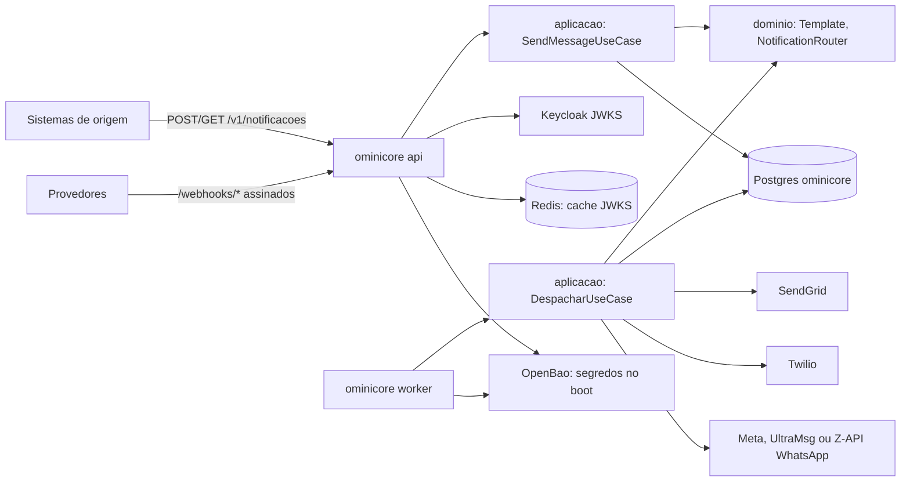

> Revisado por: Mauricio Miwa, 2026-09-28

# Mapa — ominicore

> Interpretação sobre o inventário de 2026-09-28 (`inventario.md`). Revisado por: —, —.

## O que é
Serviço interno de notificações multicanal da casa, em Go 1.27, arquitetura
hexagonal. Hoje (change `01-enviar-email`, em curso) cobre o pedido por
Template e o envio pelo Canal Email.

## Como está organizado

Camadas: `internal/dominio` (sem dependência externa) · `internal/aplicacao` e
`internal/portas` · `internal/adaptadores/{entrada,saida}/*` · `cmd/ominicore`
(subcomandos `api`, `worker`, `migrate`). A fronteira é conferida pelo
`depguard` (`.golangci.yml`).

## Áreas
| Área | O que faz | Entradas (rotas/endpoints) | Depende de |
|---|---|---|---|
| [Envio](envio.md) | pedido de Notificação por Template e despacho por Email, SMS e WhatsApp, com Retentativa e fallback | `POST`/`GET /v1/notificacoes`, `/v1/opt-outs`, `/v1/config/whatsapp`, `/webhooks/*`, worker | Keycloak, OpenBao, Postgres, Redis, SendGrid, Twilio, Meta, UltraMsg, Z-API |

## Integrações externas
| Sistema | Como é chamado | Onde |
|---|---|---|
| Keycloak | JWKS + token client_credentials | `internal/adaptadores/saida/keycloak/` |
| OpenBao | login `jwt` (ou token local, re-login quando a sessão expira) + KV v2; escrita só em `kv/
/whatsapp` (ADR 0005) | `internal/adaptadores/saida/openbao/segredos.go` |
| SendGrid | `POST /v3/mail/send` | `internal/adaptadores/saida/sendgrid/sendgrid.go` |
| Twilio | `POST .../Messages.json` (API Key) | `internal/adaptadores/saida/twilio/twilio.go` |
| Meta (WhatsApp) | `POST /v26.0/{phone_number_id}/messages` (Bearer) | `internal/adaptadores/saida/whatsapp/whatsapp.go` |
| UltraMsg (WhatsApp) | `POST /{instance_id}/messages/chat` (token no corpo) | `internal/adaptadores/saida/ultramsg/ultramsg.go` |
| Z-API (WhatsApp) | `POST /instances/{instance_id}/token/{token}/send-text` (token na URL, `Client-Token` opcional) | `internal/adaptadores/saida/zapi/zapi.go` |
| Postgres | pgx + sqlc | `internal/adaptadores/saida/postgres/` |
| Redis | cache do JWKS | `internal/adaptadores/saida/redis/cache.go` |

## Configuração
O inventário só detectou `SENDGRID_API_KEY`/`SENDGRID_REMETENTE` (lidas pelo
`deploy/local/bootstrap.sh`). As `OMINICORE_*` são lidas por
`cmd/ominicore/main.go` (`lerConfig`, via função `env` — o scanner não as vê);
lista completa em `deploy/local/README.md`. Nenhuma tem `.env` declarado: vão
para o `Infra/AMBIENTES.md` no primeiro deploy.

## Pontos de atenção
- `ReservarTentativa` segura a transação durante a chamada ao SendGrid (até
  10 s): simples e seguro contra queda, mas cada worker ocupa uma conexão por
  envio — revisar se o volume crescer (ADR 0001).
- Rajada de Retentativas depois de uma queda longa do Provedor: o jitter
  espalha, mas não há rate limit por Provedor ainda (previsto na stack, sem REQ).
